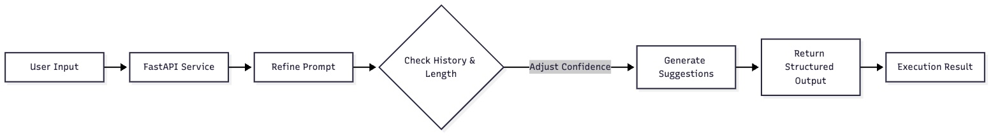
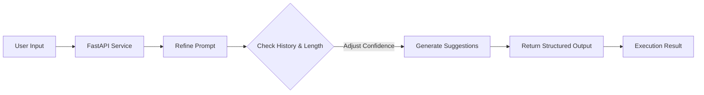

# ContextWeave

Transform unstructured user intent into structured, high-quality AI outputs through iterative refinement

# Prompt Refiner MVP

A simple FastAPI service to refine and execute prompts.

## Usage

Run the server:
```bash
uvicorn main:app --reload
```

Run tests:
```bash
pytest -q
```

Demo:
```bash
python -c "from main import demo; demo()"
```

## Architecture



<details>
<summary>Mermaid source</summary>



</details>
